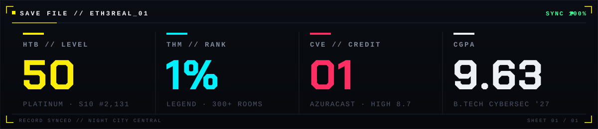

<div align="center">
  
</div>

<p align="center">
  <a href="#01--active-missions"><kbd>01</kbd> MISSIONS</a> &nbsp;·&nbsp;
  <a href="#02--gig-board"><kbd>02</kbd> GIGS</a> &nbsp;·&nbsp;
  <a href="#03--loadout"><kbd>03</kbd> LOADOUT</a> &nbsp;·&nbsp;
  <a href="#04--reputation"><kbd>04</kbd> REP</a> &nbsp;·&nbsp;
  <a href="#05--braindance"><kbd>05</kbd> BRAINDANCE</a> &nbsp;·&nbsp;
  <a href="#06--boss-fight"><kbd>06</kbd> CONTACT</a>
</p>

```console
eth3real@nightcity:~$ whoami
Mahesh Annayboeina — VAPT / penetration tester · final-year Cybersecurity B.Tech @ SAKEC

eth3real@nightcity:~$ cat mission.txt
Break systems ethically. Prove what's broken. Write it so defenders can fix it.

eth3real@nightcity:~$ status --now
> VAPT Intern @ Secforge — Andheri, Mumbai
> Open to full-time security roles — remote / relocation
```

<div align="center">
  
</div>

<div align="center">
  
</div>

## 01 // ACTIVE MISSIONS

*Three contracts on record. One objective: find the flaw before someone else does.*

| ID | OPERATION | ROLE | WINDOW | DEBRIEF |
| :-- | :-- | :-- | :-- | :-- |
| `M01` | **Secforge Pvt. Ltd.** | VAPT Intern | `2026.10 → NOW` | Web, API and network VAPT across client environments. Nessus scans, configuration reviews, and manual testing with Burp Suite, Nmap, Metasploit, sqlmap, Postman and Wireshark. Findings triaged against CVSS, OWASP Top 10 and CIS Benchmarks; client-ready remediation reports. |
| `M02` | **CyberPeace Foundation** | Cybersecurity Intern | `2025.12 → 2026.05` | Delivered cybersecurity awareness and CTF training. Built technical curriculum and coordinated student teams at competitive security events. |
| `M03` | **DΣDSEC** | Co-Founder | `2025 → NOW` | Co-founded a student security community ranked Top 30 in India on CTFtime. Led teams to 1st at X'ploitathon (200+ teams), 2nd at RAIT CTF and BYPASS CTF, and 4th at KJSSE CTF 3.0. Ran two CTF events for 75+ participants. |

<div align="center">
  
</div>

## 02 // GIG BOARD

*Field work. Pick a contract and inspect the payload.*

| ID | GIG | BRIEF | STACK | ACCESS |
| :-- | :-- | :-- | :-- | :-- |
| `G01` | **cve-research** | Coordinated disclosure archive. CVE-2026-121427 writeup, per-advisory metadata, validator and CI. | `Python` `YAML` `GitHub Actions` | [REPO →](https://github.com/Maheshannayboeina/cve-research) |
| `G02` | **Cyber-Incident-Response** | ML-assisted platform to report and respond to cyber and physical incidents: prediction, guidance, live analytics and maps. | `Flask` `Python` `Chart.js` `Leaflet` | [REPO →](https://github.com/Maheshannayboeina/Cyber-Incident-Response) |
| `G03` | **cyber-colloquy** | Official website for the SAKEC Cyber Security Department: events, achievements and projects. | `Next.js` `Tailwind` `Vercel` | [LIVE →](https://cyber-colloquy.vercel.app) · [REPO →](https://github.com/Maheshannayboeina/cyber-colloquy) |
| `G04` | **Eth3real-Notes** | Living knowledge base: TryHackMe and Hack The Box walkthroughs, CTF writeups, exploitation notes. | `GitBook` `Markdown` | [READ →](https://eth3real.gitbook.io/eth3real) · [REPO →](https://github.com/Maheshannayboeina/Eth3real-Notes) |
| `G05` | **learning_c** | Public study log while working through *Head First C* — one commit at a time. | `C` | [REPO →](https://github.com/Maheshannayboeina/learning_c) |
| `G06` | **Active Directory Offensive Security Lab** | Three-host AD range: LLMNR/IPv6 poisoning, SMB/NTLM relay, Kerberoasting, AS-REP Roasting, Pass-the-Hash, RBCD, Golden Ticket and ESC1. Attack paths mapped in BloodHound. | `Windows Server` `Active Directory` `BloodHound` | `CLASSIFIED` |

<div align="center">
  
</div>

## 03 // LOADOUT

*Everything equipped for the current build.*

<div align="center">
  
</div>

**Doctrine:** exploit → evidence → remediation. A finding is not closed until the fix is verified.

**Perks unlocked:** `CompTIA Security+` · `CRTP (expected Dec 2026)` · `APIsec ASCP (in preparation)`

**Also equipped:** Havoc · PowerShell · Docker · AWS · Flask · MySQL · Git

<div align="center">
  
</div>

## 04 // REPUTATION

*Receipts, not vibes.*

| REP | PROOF | UNLOCKED |
| :-- | :-- | :-- |
| [**CVE-2026-121427**](https://github.com/Maheshannayboeina/cve-research/tree/main/advisories/2026/CVE-2026-121427) | High 8.7 · AzuraCast config injection (CWE-15, CWE-862) · [GHSA-2wcv-vv3g-g86q](https://github.com/AzuraCast/AzuraCast/security/advisories/GHSA-2wcv-vv3g-g86q) | `2026` |
| **TryHackMe Legend** | Top 1% · 300+ rooms cleared · [profile](https://tryhackme.com/p/Eth3real) | `2026` |
| **Hack The Box Platinum** | Level 50 · Season 10 rank #2,131 · [profile](https://app.hackthebox.com/users/2298600) | `2026` |
| **BSides Mumbai CTF 2026** | Challenge author · four web and crypto challenges, including a hard and an insane web challenge; official solutions written | `2026` |
| **X'ploitathon 2026** | 1st place / 200+ teams with DΣDSEC | `2026` |
| **CTF podiums** | 2nd RAIT CTF · 2nd BYPASS CTF · 4th at KJSSE CTF 3.0 | `2026` |
| **DΣDSEC** | Co-founder · Top 30 in India on CTFtime · two events for 75+ participants · [community](https://www.linkedin.com/company/teamdedsec) | `2025 →` |
| **CGPA 9.63 / 10** | B.Tech Cybersecurity, SAKEC · expected 2027 | `2027` |

<div align="center">
  
</div>

## 05 // BRAINDANCE

*Jack in. The notes are the memory.*

| ARCHIVE | WHAT'S INSIDE | JACK IN |
| :-- | :-- | :-- |
| **ETH3REAL Notes** | TryHackMe and Hack The Box walkthroughs, CTF event writeups, exploitation notes. Continuously updated. | [GITBOOK →](https://eth3real.gitbook.io/eth3real) · [SOURCE →](https://github.com/Maheshannayboeina/Eth3real-Notes) |
| **CVE Research** | Coordinated disclosure archive: advisory writeups, machine-readable metadata, disclosure policy and validation CI. | [REPO →](https://github.com/Maheshannayboeina/cve-research) |

> *The city is a dataset. Learn to read it.*

<div align="center">
  
</div>

## 06 // BOSS FIGHT

*Final encounter: **The Recruiter**. HP: ∞. Weakness: shipped work, clear reports, CTF receipts.*

```text
[ BOSS ENCOUNTER ]  THE RECRUITER
HP          ∞
WEAKNESS    evidence, clarity, receipts
DROP        full-time security role
```

| CONTRACT | DETAIL |
| :-- | :-- |
| **OPEN TO** | VAPT · Penetration Testing · Red Team · Security Research |
| **BASE** | Mumbai, IN · remote or relocation |
| **NEXT STEP** | send a mission brief to the email below |

<p align="center">
  <a href="mailto:maheshannayboeina@gmail.com"></a>
  <a href="https://www.linkedin.com/in/mahesh-annayboeina-06536428b"></a>
  <a href="https://tryhackme.com/p/Eth3real"></a>
  <a href="https://app.hackthebox.com/users/2298600"></a>
</p>

**Direct:** [maheshannayboeina@gmail.com](mailto:maheshannayboeina@gmail.com) · resume available on request.

<details>
<summary><code>[ CLASSIFIED // DECRYPT PAYLOAD ]</code></summary>

<br>

A message is buried in the city grid:

```text
ZmxhZ3tuM3Yzcl9mNGQzXzR3NHlfczRtdXI0MX0=
```

`base64 -d` is your friend. First runner to email me the decoded line gets a shout-out in the next build.

</details>

<div align="center">
  
</div>

<p align="center">
  <sub>© 2026 Mahesh Annayboeina · ETH3REAL · Mumbai, IN · Night City never sleeps.</sub>
</p>
